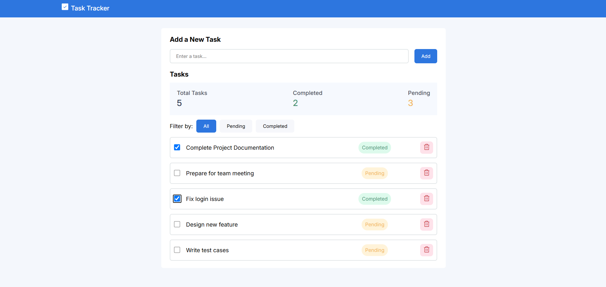
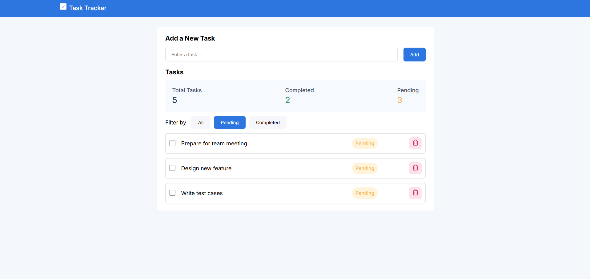

# Task Tracker

A simple task management application built with React and Vite. The application allows users to add tasks, mark them as completed, filter tasks by status, and delete tasks.

## Features

- Add new tasks
- Mark tasks as completed or pending
- View total, completed, and pending task counts
- Filter tasks by:
  - All
  - Pending
  - Completed
- Delete tasks
- Responsive user interface
- Phosphor Icons integration

## Technologies Used

- React 18
- Vite
- JavaScript
- CSS
- Phosphor Icons

## Getting Started

### Prerequisites

Install the following before running the application:

- [Node.js](https://nodejs.org/) 16 or later
- npm

### Installation

Clone the repository:

```bash
git clone https://github.com/ShreehariNair/task-tracker.git
```

Navigate to the project directory:

```bash
cd task-tracker
```

Install the project dependencies:

```bash
npm install
```

## Running the Application

Start the development server:

```bash
npm run dev
```

The application will be available at:

```text
http://localhost:5173
```

The exact URL may be displayed in the terminal after starting the development server.

## Available Scripts

### Start the development server

```bash
npm run dev
```

### Build the application for production

```bash
npm run build
```

### Preview the production build

```bash
npm run preview
```

### Run ESLint

```bash
npm run lint
```

## How to Use

1. Enter a task in the input field.
2. Click the **Add** button.
3. Use the checkbox next to a task to mark it as completed.
4. Use the **All**, **Pending**, and **Completed** buttons to filter tasks.
5. Click the trash icon to delete a task.

## Data Storage

Tasks are stored in the application's current session using React state. Refreshing the page will reset the task list.

## Screenshots

Add screenshots of the application below for submission.

### Main Application



### Pending Tasks Filter



## Project Structure

```text
task-tracker/
├── public/
├── src/
│   ├── assets/
│   ├── App.css
│   ├── App.jsx
│   └── main.jsx
├── index.html
├── package.json
└── README.md
```

## Deployment

Check the deployment at https://tasktrack1.netlify.app

## Repository

[View the project on GitHub](https://github.com/ShreehariNair/task-tracker)

## License

This project is intended for educational and demonstration purposes.
